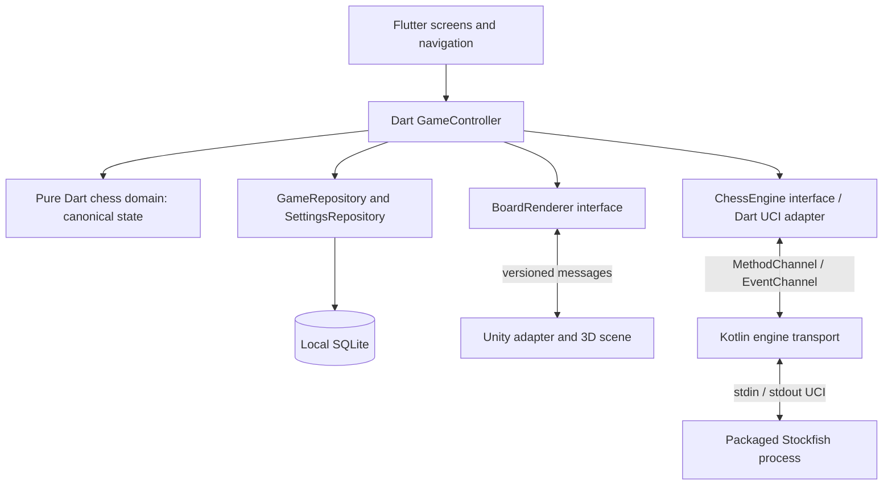

# Android 3D Chess: architecture and implementation plan

Research date: 2026-11-01 (Asia/Seoul). Status: architecture proposed; integration dependencies require the validation gates below. This document does not claim that an integrated application has been built or tested.

## 1. Scope and core decisions

Build an offline Android application with Flutter screens and a Unity-rendered, genuinely three-dimensional chessboard: mesh pieces, perspective camera, lighting, raycast touch picking, orbit/zoom controls, and move animations. The first release supports standard chess against Stockfish, local game resume/history, and settings. Same-device two-player play can reuse the controller later. Online multiplayer, accounts, authentication, Firebase, cloud synchronization, ads, and analytics are outside this version.

1. **Flutter/Dart owns all chess rules and canonical game state.** A pure-Dart domain layer validates every human and AI move, generates legal moves, adjudicates results, and produces FEN/SAN/PGN. Flutter also owns navigation, settings, promotion dialogs, history, and AI orchestration.
2. **Unity is a presentation client.** It owns meshes, visual square-to-world mapping, touch detection, camera motion, audio/visual effects, and animations. It renders snapshots and animation instructions supplied by Flutter. It never commits a move, computes legal moves, declares a result, or persists a game.
3. **Stockfish is an offline move provider.** It receives a position plus history through UCI and returns a candidate move. Its internal search position is disposable; its result must pass the same Dart validation as a human move.
4. **Use explicit adapters at both native boundaries.** No Unity or engine package types may enter the chess domain. Plugin changes must leave rules, persistence, and game orchestration intact.
5. **Do not select a Flutter–Unity plugin yet.** Research identifies a first candidate, but the installed combination has not been tested. Phase 0 must record exact compatible versions and real-device release-build results before adoption.
6. **Prefer a separate packaged Stockfish process using UCI.** Prove modern Android packaging and execution in Phase 0. Do not silently substitute in-process GPL engine linking; that changes the license analysis.
7. **Use SQLite for durable games and settings.** Keep one transaction boundary for canonical moves and associated metadata. Access through Dart repositories; choose and pin a Flutter SQLite adapter after compatibility/license review.

## 2. Current workspace and compatibility evidence

Read-only inspection found an empty project directory: no Flutter manifest, Unity project, Gradle wrapper, or existing application constraints. No application or integration tests were run.

| Item | Observed locally | Consequence |
| --- | --- | --- |
| Flutter / Dart | Flutter 3.47.2 stable, revision `d3b14c876900e553bc736ca19295fc09e3853e8e`; Dart 3.13.2 | Starting candidate, not proof of plugin compatibility |
| Unity | No `Unity`/`unity` executable on PATH; no editor found under `/Applications/Unity/Hub/Editor` | Exact editor/patch and Android module still need installation or discovery in another location |
| Java | PATH Java is Temurin 23.0.1 | Do not assume Gradle or Unity uses or supports this JDK; explicitly configure the validated JDK |
| Android SDK | Platforms 31, 33–36, 36.1, 37.0; build-tools 35.0.0, 35.0.1, 36.0.0, 36.1.0 | SDK availability does not establish host build compatibility |
| NDK | 25.1.8937393, 27.1.12297006, 28.2.13676358 | Install the exact Unity-required NDK if different; engine may use a separate pinned NDK |
| Device | `adb devices -l` has no connected devices | Real-device qualification remains pending |

### Flutter–Unity options researched

| Option | Primary-source evidence | Decision |
| --- | --- | --- |
| `flutter_unity_widget` | pub.dev lists stable 2022.2.1 and marks it discontinued. Repository documentation lists Unity through 2022.3.x, Flutter >=3.16.0, and points elsewhere for Unity 6 support. [Package](https://pub.dev/packages/flutter_unity_widget), [repository](https://github.com/juicycleff/flutter-unity-view-widget). | Do not adopt for this new project. Old minimum-version claims do not prove Flutter 3.47.2 compatibility. |
| `flutter_embed_unity` | Stable 2.0.0 advertises Unity 2022.3 and 6000.0/6000.3, Flutter 3.22+, with a separate Unity 6 Android implementation (`flutter_embed_unity_6000_0_android`, example 1.2.3). It warns about undocumented Unity APIs and embedding workarounds. [Maintainer documentation](https://pub.dev/packages/flutter_embed_unity). | First candidate for a spike, not a selected dependency. Resolve and inspect exact package/export-script versions; reconcile README instructions with actual dependency metadata. |
| Custom Android Unity-as-a-Library host | Unity documents importing `unityLibrary`, a single runtime, and full-screen-only rendering. [Unity integration manual](https://docs.unity.com/en-us/engine/6000.6/manual/platform-specific/android/developing/unityasa-library). | Fallback: full-screen Unity activity, Android relay to a retained Flutter engine. More native maintenance; avoids depending on a widget plugin. |

Start the spike with a security-patched Unity 6000.3 LTS editor. Do not automatically choose the newest Unity stream: it may fall outside the candidate plugin's stated range. The candidate maintainer lists Android security floors of 6000.3.0f1 / 6000.0.58f2, but use current patched releases, not those minimums as release recommendations. Its MIT license also needs archiving with the actual locked package. [Candidate requirements](https://pub.dev/packages/flutter_embed_unity).

Toolchain compatibility is patch-specific. Unity's current 6000.3 table lists Gradle/AGP 8.13/8.10.0 for 6000.3.1–16, 9.1.0/9.0.0 for 17–25, and 9.3.1/9.1.1 for 26+. Therefore, do not copy an older plugin README's Gradle settings into a newer export. Confirm the chosen editor's JDK/NDK requirements, Flutter's supported AGP/Kotlin setup, and all plugin build scripts together. A separately built Unity AAR may isolate compilation toolchains, but still requires runtime/package testing. [Unity compatibility table](https://docs.unity.com/en-us/engine/6000.3/manual/platform-specific/android/introducing/gradle-overview/version-compatibility).

### Phase 0 selection gate

Before adding a production dependency, create a minimal Flutter screen with a Unity cube/board placeholder and bidirectional messages. Record a compatibility report in this document or `docs/compatibility.md` containing:

- Flutter/Dart revisions, editor patch and modules, render pipeline, graphics API, Unity activity type, scripting backend, package versions/commits, export-script checksum, Android API levels, Gradle, AGP, Kotlin, JDK, SDK, NDK, ABI, and device build fingerprints.
- Review date, primary links, unresolved upstream issues, all required patches, license notices, and reproducible build commands. Pin dependencies and commit Dart/Unity lockfiles and Gradle wrapper.
- Successful clean debug APK **and release AAB** builds, install of bundle-generated split APKs, 100 message round trips, 20 enter/leave cycles, touch/overlay hit testing, background/resume, Back, rotation, and process-death recovery on physical Android hardware.
- Check Flutter rendering backend versus Unity surface composition, black/frozen frames, focus and input ownership, lifecycle behavior, and retained memory. Test graphics backends rather than inheriting AR-specific package advice; this app does not need AR/XR packages.

Only after these pass, select the adapter and exact tuple in an architecture update. A package resolving in `pub` or a successful Unity export is not a pass. If widget embedding fails, test the full-screen activity fallback before expanding game implementation. Do not downgrade target SDK or use an unpatched editor to make a plugin build.

The intended UI is a Flutter game screen with a Unity board area and Flutter HUD/dialogs. This is conditional on widget composition passing. The fallback gives Unity the full display and returns to Flutter for app screens; Flutter remains alive to orchestrate play. Any required in-game visual HUD in that fallback receives display-only values and emits intents; promotion choices can temporarily return to Flutter. This UX tradeoff must be recorded if fallback is selected.

## 3. Components and dependency direction



Arrows show dependencies, not authority transfer. Unity and Stockfish receive projections of Dart state. Neither writes the database or communicates directly with the other.

| Component | Responsibilities | Public boundary |
| --- | --- | --- |
| Flutter presentation | Home/new game, side/difficulty, game HUD, move list, promotion, settings, history/replay, About/licenses; accessibility labels | Commands to controller; immutable view-state stream |
| `GameController` | Serialize commands, validate turn/input context, commit moves, persist, schedule/cancel AI, recover/resume, coordinate render state | `newGame`, `selectSquare`, `attemptMove`, `choosePromotion`, `undoTurn`, `resign`, `claimDraw`, `resumeGame`, `setPreferences` |
| `ChessRules` / `GameState` | Legal move generation, king safety, special moves, counters, repetition, results; immutable transitions; serialization | `legalMoves`, `applyLegalMove`, `adjudicate`, `toFen`, `toPgn`, replay |
| `BoardRenderer` adapter | Encode/validate protocol, manage readiness, acknowledgments and resync; own Unity dependency | `attach`, `render`, `configure`, `setInputEnabled`, `pause`, `detach`; event stream |
| Unity scene | 3D board/piece meshes, raycasts, drag preview, camera orbit/zoom/flip, lighting, visual/audio animation | Receive render/configuration commands; emit intents/readiness/animation events |
| Dart `ChessEngine` / UCI adapter | Search scheduling contract, UCI session/parser, mapping difficulty to discovered options, result correlation | `initialize`, `search`, `cancel`, `dispose`; typed events |
| Kotlin engine transport | Locate packaged ABI engine, launch/stop process, byte/line IO, lifecycle cleanup, timeout/exit reporting | Channels below; no chess rules |
| Repositories | Atomic persistence, migrations, history queries, restore integrity checks, preferences | `commitGame`, `loadGame`, `listGames`, `loadSettings`, `saveSettings` |

The chess domain must have no Flutter widget, Unity, Android, database, or Stockfish imports. Adopt a maintained pure-Dart rules library behind `ChessRules` only after license review and rule-conformance tests; otherwise implement that module independently. Do not use Stockfish as the rules API. Pick one canonical rules implementation rather than maintaining a second C# version.

## 4. Canonical game model and move lifecycle

`GameState` contains `gameId`, monotonically increasing `revision`, initial position/FEN, ordered UCI move history, current position, side to move, castling rights, en-passant target, halfmove/fullmove counters, repetition keys/counts, mode, human color, difficulty, result/termination reason, and timestamps. SAN is generated by Dart. FEN is an interchange snapshot, not a complete game: it cannot recover repetition history.

Standard chess only; no Chess960. Dart handles castling through check, en passant exposing check, all four promotions, checkmate, stalemate, dead positions, repetition, and move-count draws. Distinguish claimable threefold/50-move draws from automatic fivefold/75-move draws and preserve checkmate precedence. Include claim-by-intended-move behavior. A library's insufficient-material helper is not necessarily complete dead-position adjudication; document supported coverage and close rule gaps before claiming full rules conformance. Untimed games ship first; clocks are a future Flutter-owned feature.

Use a single serialized command queue in Dart. UI/controller phases: `loading`, `humanTurn`, `promotionPending`, `aiThinking`, `paused`, `finished`, `recoverableError`. Render readiness/animation state is separate from the game result. Every restart, undo, or reload invalidates outstanding work using session and revision tokens; revisions never rewind when moves are undone.

Human-move sequence:

1. Unity raycasts a square and reports its algebraic ID. Flutter checks the current session, revision, turn, and readiness, and computes allowed highlights in Dart.
2. Unity reports a destination tap or drag intent. A drag may show a ghost, but cannot replace the committed piece layout. Flutter rejects an illegal destination without changing game state.
3. If promotion is required, Flutter presents a promotion dialog; no move is committed until a piece is selected. Unity cannot default to a queen or decide that promotion is required.
4. Dart applies the legal move, generates SAN/result/repetition data, increments revision, and atomically persists the new aggregate. Publish only after successful commit. On storage failure, keep the prior committed state and show retry; the renderer snaps back.
5. Send the committed snapshot plus optional animation plan to Unity. It animates, then acknowledges. An acknowledgment never commits a move. A timeout triggers a nonanimated snapshot; it must not deadlock play.
6. If the committed position is active and it is the AI's turn, request a bounded search. Validate the returned UCI move in Dart, then use steps 4–5 again. Schedule animations/input so rapid events cannot create a second move.

Undo against AI means return to the preceding human decision point, including the one-ply case while AI is thinking. Cancel/drain the search, rebuild from initial position and retained moves, increment revision, commit, and resync. History replay uses a separate read-only projection and never changes the active game.

## 5. Flutter ↔ Unity protocol

The normative version 1 wire contract, message examples, readiness/resync lifecycle, ordering rules, and special-move instructions are in [unity_flutter_bridge.md](unity_flutter_bridge.md). Its concrete message names and FEN representation supersede the preliminary protocol sketch.

Flutter sends complete six-field FEN snapshots plus explicit display state. Unity parses piece placement for rendering only; it never derives legal moves or results. Move animation commands contain explicit relocations, captured squares, promotion mesh changes, and a complete target snapshot. Castling moves king and rook together; en passant removes the explicitly identified pawn; promotion uses the exact Flutter-selected piece.

The host provisions a fresh session before each Unity attachment. Unity announces readiness, Flutter sends its latest committed snapshot, and interaction waits for application. Commands before readiness are coalesced into the latest snapshot rather than replayed. Session/game IDs, monotonic revisions and command sequences, message deduplication, animation IDs, and tween generation guards prevent stale messages and callbacks from altering the displayed board. Reload, undo, timeout, and mismatch recover through a complete nonanimated snapshot.

Keep plugin-specific calls inside the adapter. With the custom host, Dart uses platform channels to Kotlin, Kotlin dispatches to the selected editor's Unity Java messaging API, and C# reports events through an Android Java bridge back to Kotlin. Marshal Unity scene changes to its main thread and Flutter callbacks to the Android UI thread. The exact Unity API/class names must match the validated editor export.

## 6. Flutter ↔ Android ↔ Stockfish

### Transport and native packaging

Use an app-owned Android plugin with `MethodChannel("chess/engine/control/v1")` and `EventChannel("chess/engine/events/v1")`. Control methods: `start`, `writeLine`, `stopProcess`, `dispose`. Events: `started`, `stdoutLine`, `stderrLine`, `exited`, `transportError`, each with an engine generation token. Start/write return transport acknowledgment, not a chess result. Dart's UCI session converts raw lines into typed `EngineInfo`, `BestMove`, and `EngineFailure` events. Flutter documents asynchronous channels and thread requirements; native process IO must run off the UI thread. [Flutter platform channels](https://docs.flutter.dev/platform-integration/platform-channels).

Compile the official Stockfish source to an Android ARM64 PIE executable with the NDK and required NNUE data embedded. Proposed packaging: ship the executable under `lib/arm64-v8a/libstockfish_exec.so`, arrange installer extraction into `applicationInfo.nativeLibraryDir`, and launch the installed file with `ProcessBuilder` using its absolute path and pipes. The `.so` suffix is a packaging convention here; this is an executable, not a library loaded with JNI. This approach is **an unproven project integration choice**, not an Android guarantee. Check release stripping/packaging does not corrupt it and verify the file exists/is executable after installation from AAB-derived splits.

Configure extraction through the chosen AGP's native-library packaging DSL, then inspect generated manifests and split APKs. Android documents the extraction setting and recommends the Gradle DSL for modern AGP. [Android application manifest reference](https://developer.android.com/guide/topics/manifest/application-element#extractNativeLibs).

Do not copy an executable into writable app storage and `chmod`/execute it: Android 10+ targeting restrictions prohibit executing code from the writable app home directory. No network engine downloads, arbitrary engine paths, or shell command construction. [Android execution restriction](https://developer.android.google.cn/about/versions/10/behavior-changes-10?hl=en).

Phase 0 must prove engine startup under target API 36+, on both 4 KB and 16 KB configurations, from a release bundle install. If this packaging fails, investigate a documented alternative or separate Android service architecture. JNI/FFI in-process Stockfish is a separate decision requiring license clearance, especially alongside proprietary Unity runtime components; it is not an automatic fallback. Keep `ChessEngine` unchanged while resolving transport.

### UCI session and correctness

Use one engine and at most one active search. Initial session:

```text
Flutter -> uci
Engine  -> id ..., option ... (zero or more), uciok
Flutter -> setoption name Threads value 1
Flutter -> setoption name Hash value 32
Flutter -> isready
Engine  -> readyok
Flutter -> ucinewgame
Flutter -> isready
Engine  -> readyok
Flutter -> position startpos moves e2e4
Flutter -> go movetime 500
Engine  -> info ... (zero or more)
Engine  -> bestmove e7e5
```

This is an illustrative exchange. Discover supported options and bounds during handshake; clamp preferences rather than assuming options exist. Default to one thread, 32 MiB hash, no pondering, bounded time; expose difficulty presets using available strength options. Never advertise precise Elo calibration without testing. UCI's position/history, search, readiness, and stop behavior are documented by Stockfish. [Official UCI reference](https://official-stockfish.github.io/docs/stockfish-wiki/UCI-Protocol-and-Stockfish-Commands.html).

Send `position startpos moves ...` for normal games, or `position fen <initialFen> moves ...` for supported nonstandard starting positions. Replaying history preserves repetition context that current FEN alone loses. Full FEN can be sent for isolated analysis, but is not sufficient for gameplay history. Stockfish gets a position derived only from Dart-validated moves.

Each Dart request has `{engineGeneration, searchId, gameId, revision, positionHash, initialFen, moves, limits}`. UCI itself does not echo request IDs: the Dart session associates its single active search with these tokens. Before accepting `bestmove`, require all tokens/current position to match, the AI turn to remain active, and the move to be legal under Dart rules.

Cancellation sends `stop` and drains the old `bestmove` before starting a new search. `readyok` alone is not proof that the previous search finished. Do not reuse the session until this barrier completes; on timeout terminate/restart and increment engine generation. Handle partial/multiple lines per read, `info` bursts (throttle UI updates), malformed output, unexpected exit, and `bestmove 0000`/`(none)`. Dart independently determines whether there are no legal moves. On illegal/absent output from an active position, retain the committed board, allow bounded restart/retry, and offer retry or exit without inventing a move.

On background or navigation away, invalidate requests and stop search; no background service or wake lock. On resume, restart if necessary and send the complete position/history. Destroy/reap the process after a bounded quit/stop timeout; drain both stdout and stderr to avoid deadlock. A child crash must not mutate game state.

## 7. Persistence and recovery

Use an app-private SQLite database accessed by repositories, preferably on a database worker isolate. Proposed schema:

- `games`: ID, schema/rules version, initial FEN, latest FEN, monotonic revision, mode, human color, difficulty snapshot, result, termination, timestamps.
- `moves`: game ID + ply primary key, UCI, SAN, optional resulting FEN/checksum. Ordered move history is the recovery authority; resulting FEN is a validation/cache field.
- `settings`: typed keys/values and schema version for sound, graphics quality, camera orientation, reduced motion, and difficulty defaults.

Commit the move row, game revision/current snapshot, and result in one transaction before publishing. New game, undo, resignation, and draw claims are also transactional. Repetition state is reconstructible by replay; do not trust a saved counter over replay. Validate loaded data, replay legal moves, and compare the resulting snapshot/checksum. Quarantine/report corrupt records without overwriting them silently. Version migrations and test upgrade/rollback-failure handling.

Restore from storage after Android process death. Promotion selection is transient; after restore the uncommitted pawn move can be requested again. No reliance on Unity scene memory or Android saved-instance bundles for durable games. Settings/history need no broad storage permission. Future user-selected PGN export can use the Storage Access Framework. Explicitly disable Android cloud backup for v1, with both legacy and modern backup rules, so “local” does not silently imply cloud backup; document uninstall clearing data.

## 8. Repository layout and Android build strategy

Proposed layout (create application files during implementation):

```text
docs/architecture.md
docs/compatibility.md                   # exact validated tuple and evidence
app/                                   # Flutter project
  lib/app/                             # navigation, DI, theme
  lib/features/{game,history,settings}/
  lib/domain/chess/                     # rules adapter and immutable models
  lib/application/                     # GameController and use cases
  lib/data/                            # SQLite repositories/migrations
  lib/integrations/{unity,stockfish}/
  android/                             # sole application/launcher Gradle module
  test/  integration_test/
packages/android_engine_bridge/        # Flutter plugin + Kotlin process transport
unity/ChessBoard/                       # Assets, Packages, ProjectSettings
native/stockfish/                       # pinned source reference, patches, build scripts
tools/                                 # Unity export, engine build, bundle checks
third_party/licenses/                  # notices, source manifest, asset inventory
```

Keep generated `unityLibrary`/AARs and native binaries in a reproducible artifact location, imported by the Flutter Android host. The final location depends on the chosen adapter's exporter; do not assume an exporter supports arbitrary layouts. Commit export scripts, source revisions/checksums and patches, not Unity `Library/`, Gradle caches, or signing secrets. Unity binary assets may use Git LFS.

Build pipeline:

1. Pin Flutter and Unity editor patch; install Android build support/IL2CPP and matching toolchains. Use Unity URP with mobile shaders, modest texture/poly counts, limited shadows, and no unused XR/network packages.
2. Compile pinned Stockfish/NNUE assets for `arm64-v8a`, baseline compatible ARM64 instructions. Optional optimized variants require CPU feature detection; no desktop/x86 binaries in the shipping ARM64 artifact.
3. Batch-export Unity as `unityLibrary` or a validated AAR. Use IL2CPP and ARM64. Integrate only the library, not Unity's standalone launcher application. Apply repeatable template patches instead of editing generated exports by hand.
4. Build with one explicitly chosen host Gradle/AGP/Kotlin/JDK tuple; separately pinned module NDKs are possible. Resolve manifest merging, activity/lifecycle declarations, C++ runtime collisions, R8/JNI keep rules, ABI filters, duplicate resources and native symbols deliberately. Never solve duplicates with blind `pickFirst` rules.
5. Build debug APK for iteration, profile build for measurements, and signed release AAB for distribution. Use an upload key held outside the repository and Play App Signing. Keep native symbols and obfuscation maps for crash diagnosis.
6. Produce bundle-generated split APKs with bundletool and install on physical hardware. Validate native files and extraction, UCI execution, Unity content, and shrinking in the installed release artifact.
7. Run all correctness/contract checks in CI. Unity export jobs require licensed editor provisioning; cache by input hashes and perform clean reproducibility checks. Store the dependency/source manifest with every release.

Product choice: initially support ARM64 devices, with `minSdk` provisionally API 26 (Android 8). This is a deliberate support floor, not a vendor compatibility claim; raise it if validated dependencies require it. ARMv7 may be added only with complete Flutter/Unity/engine coverage. Keep the ABI set consistent across all components.

As researched, new Play phone/tablet submissions and updates must target Android 16 / API 36 or higher from 2026-08-31. Set `compileSdk >= targetSdk` and recheck Play requirements at release; an older Unity export target is not acceptable. [Play target API requirements](https://support.google.com/googleplay/android-developer/answer/11926878?hl=en-mt).

All native code, including Flutter, Unity/IL2CPP, Stockfish and transitives, must work on 16 KB page-size devices. Check ELF segment alignment and APK ZIP alignment with Android's prescribed tools, inspect AAB page-alignment metadata, and run on a 16 KB environment. NDK r28+ defaults help newly built engine code, but cannot repair incompatible prebuilt Unity/plugin binaries. [Android page-size guidance](https://developer.android.com/guide/practices/page-sizes).

## 9. Validation and real-device acceptance

| Layer | Required tests / acceptance |
| --- | --- |
| Dart rules | Published perft fixtures and move-generation comparisons; pinned-piece/check legality, both castlings, castling through attacked squares, en passant discovered check, underpromotions, SAN/FEN/PGN round trips, repetition, draw claims/automatic draws, result precedence, undo/replay |
| Controller | Human/AI alternation, promotion cancellation, double taps, stale events, undo during search, engine illegal move/crash/timeout, storage failure, result transitions; fake engine/renderer keep tests deterministic |
| Bridge contracts | JSON validation, unsupported versions, duplicates, reordered/dropped events, old-session responses, missed animation acknowledgment, snapshot resync, all special-move animation payloads |
| Native engine | UCI handshake/search/stop/restart, partial output, option bounds, pipe backpressure, no UI-thread IO; compare a fixture position's legal returned move rather than requiring one particular AI move |
| Storage | Atomicity, crash between commits/render, migrations from prior schema, corrupt replay, restore after OS kill, history and settings consistency |
| Unity | Editor/PlayMode tests for square mapping at camera extremes, picking/gesture disambiguation, stable piece IDs, explicit capture/castling/promotion animations, authoritative snapshot replacement |
| Integrated Android | Debug, profile, and minified release/bundle installs; full game in airplane mode, resume/replay/settings, background during animation/search, repeated navigation, rotation, Back, lock/unlock, process death, interruptions, denied network access |

Physical device matrix: at least one lower-memory ARM64 phone at the supported floor, a mid-range phone with a different GPU vendor, and a modern Android 15/16+ phone; include a device or supported system configuration with 16 KB pages. Use emulators for supplementary API/page-size coverage, not as the only 3D qualification. Document exact model/OS/GPU and `adb shell getconf PAGE_SIZE` results.

Initial measurable targets, to validate in the spike: responsive touch feedback within 100 ms; 60 fps on the mid-range reference phone and stable 30 fps low-quality mode on the lower-end phone; cold board ready within 5 seconds on the reference device; no sustained memory growth across 20 navigation cycles; no ANR/crash during a 30-minute AI session. Measure CPU/GPU frame times, total Flutter+Unity+engine memory, thermal throttling and battery behavior. Set a concrete memory ceiling per selected reference device after the spike. Do not assume unloading Unity returns all runtime memory or invoke Unity quit if it terminates the host process.

## 10. Licenses and Google Play release gates

Stockfish is GPLv3. Every distributed engine binary must have its license and access to corresponding exact source, including modifications and build material. Archive the engine tag/commit, patches, compiler flags/toolchain, scripts, NNUE files/hashes and their notices; publish the matching source alongside the release and link it from About/licenses. A generic upstream homepage or latest source branch is insufficient. Do not assume neural-network assets have no attribution requirements. [Stockfish redistribution terms](https://raw.githubusercontent.com/official-stockfish/Stockfish/master/README.md), [license text](https://github.com/official-stockfish/Stockfish/blob/master/Copying.txt).

The process/UCI boundary is a design choice intended to keep the engine independent, not a guarantee that the entire distribution avoids GPL obligations. The FSF discusses both communication mechanism and semantics; linking in one address space presents materially different concerns from ordinary pipes between independent programs. Review the actual distribution, source-delivery obligations, user rights, and Unity runtime/license compatibility before shipping. If required terms cannot coexist, resolve the engine/distribution design before release. [GNU GPL FAQ](https://www.gnu.org/licenses/gpl-faq.en.html#MereAggregation).

Confirm the team's Unity license tier, editor/runtime redistribution conditions and any splash-screen obligations against the current agreement; the commercial Unity runtime is not made open source by using an open-source Flutter plugin. [Unity Editor terms](https://unity.com/legal/editor-terms-of-service/software).

Maintain a third-party inventory for Flutter/Dart packages, native libraries, Unity packages, chess meshes, textures, fonts, shaders and sounds. Archive each exact license, attribution and proof of asset purchase/permission; do not assume Asset Store source assets may be redistributed publicly. Prefer original or clearly licensed assets. Generate an in-app notices screen and verify that the selected Dart rules/storage libraries permit the planned distribution.

Play checklist before production:

- Recheck target API, native 64-bit/16 KB compatibility, AAB size/download limits and signed release installation. Use compression/asset optimization first; Unity's UaaL documentation rules out Play Feature Delivery dynamic-module hosting for the runtime.
- Test an internal-track install and Play pre-launch reports; satisfy any account-specific closed-testing/production-access requirements shown in Play Console.
- Complete content rating, target-audience and Data safety forms from actual shipped behavior. Verify transitives do not add telemetry/ads unexpectedly. Provide a privacy policy accurately describing local-only data and backup behavior.
- Keep release permissions minimal: no authentication, broad storage access, notifications or background services are needed. Remove unused network permissions/SDKs after checking framework/runtime needs; do not describe “no collection” solely because Firebase is absent.
- Verify accessibility of Flutter controls, privacy/license links, source availability, Android Back/edge-to-edge layout, release crash diagnostics and upgrade/migration behavior.

## 11. Phased implementation plan

| Phase | Deliverables | Exit gate |
| --- | --- | --- |
| 0. Integration and license feasibility | Inventory tools; choose candidate editor; minimal Flutter–Unity exchange; separate Stockfish process proof; exact compatibility report; licensing/distribution assessment | Physical-device debug and release bundle paths work with target API and page-size requirements; select and pin integration only after evidence |
| 1. Dart core and contracts | Flutter scaffold, pure-Dart rules adapter, immutable state/controller, protocol schemas, fake renderer/engine, repository interfaces | Rule-conformance and stale-event tests pass; domain has no platform dependencies |
| 2. Durable offline game shell | Home/new-game, game HUD/promotion, settings/history/replay, SQLite schema/migrations, resume | Complete games run with fakes; commit/replay/process-death behavior verified |
| 3. Real 3D board | Mobile Unity scene/assets, camera/touch, snapshot renderer, explicit animations, selected bridge | Physical-device picking and special moves match Dart state; recovery and navigation tests pass |
| 4. Offline Stockfish AI | Reproducible engine artifacts/NNUE, Kotlin transport, Dart UCI session, difficulty, cancel/restart | Airplane-mode games complete; undo/background/stale-bestmove/crash handling pass |
| 5. Device optimization | Quality tiers, reduced motion, input/accessibility, resource profiling, release shrinking/package checks | Device matrix and performance targets pass; no unresolved native compatibility failures |
| 6. Play readiness | Signing, AAB/internal testing, notices/exact source publication, privacy/store metadata, CI/release runbook | Installed Play artifact works; license and policy gates resolved; reproducible signed release approved |

Dependencies: Phase 0 precedes plugin adoption and engine packaging commitment. Phases 1–2 can proceed with fakes once contracts are stable. Phases 3–4 integrate through those contracts, then Phase 5 validates the combined resource budget. Phase 6 is a release gate, not permission to postpone engine licensing until the end.

The next concrete implementation step is Phase 0, not a full chess UI: establish the exact Flutter–Unity–Android toolchain, demonstrate a legal offline engine transport, and preserve the evidence needed to make the dependency choice reviewable.
